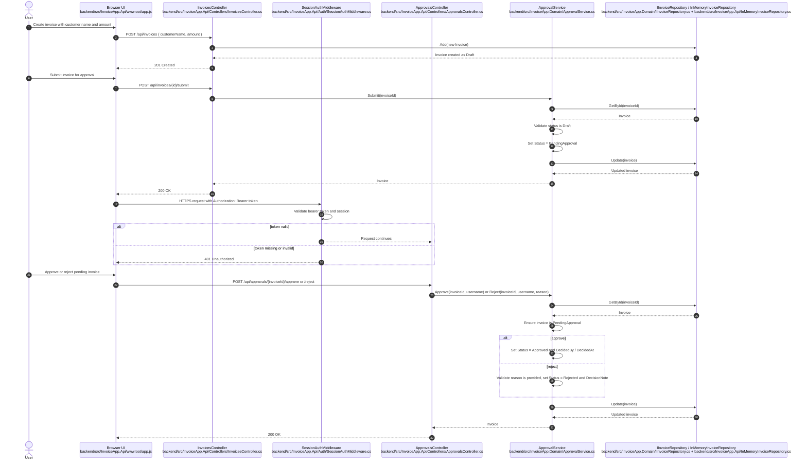

# Approval Sequence Diagram

# Citations

## Participants

- User: this is the browser user interacting with the demo app; the flow is initiated in [backend/src/InvoiceApp.Api/wwwroot/app.js](../backend/src/InvoiceApp.Api/wwwroot/app.js).
- Browser UI: the static UI sends API calls for invoice creation, submission, and approval; see [backend/src/InvoiceApp.Api/wwwroot/app.js](../backend/src/InvoiceApp.Api/wwwroot/app.js).
- InvoicesController: creates and submits invoices via `Create`, `Submit`, and `GetAll` endpoints in [backend/src/InvoiceApp.Api/Controllers/InvoicesController.cs](../backend/src/InvoiceApp.Api/Controllers/InvoicesController.cs).
- SessionAuthMiddleware: validates bearer tokens before protected `/api` requests in [backend/src/InvoiceApp.Api/Auth/SessionAuthMiddleware.cs](../backend/src/InvoiceApp.Api/Auth/SessionAuthMiddleware.cs).
- ApprovalsController: handles approval and rejection actions for pending invoices in [backend/src/InvoiceApp.Api/Controllers/ApprovalsController.cs](../backend/src/InvoiceApp.Api/Controllers/ApprovalsController.cs).
- ApprovalService: owns the lifecycle transitions in `Submit`, `Approve`, `Reject`, and `EnsurePending` in [backend/src/InvoiceApp.Domain/ApprovalService.cs](../backend/src/InvoiceApp.Domain/ApprovalService.cs).
- IInvoiceRepository / InMemoryInvoiceRepository: the persistence contract and in-memory implementation are in [backend/src/InvoiceApp.Domain/IInvoiceRepository.cs](../backend/src/InvoiceApp.Domain/IInvoiceRepository.cs) and [backend/src/InvoiceApp.Api/InMemoryInvoiceRepository.cs](../backend/src/InvoiceApp.Api/InMemoryInvoiceRepository.cs).

## Interactions

- `User -> Browser`: invoice creation and submit actions are wired in [backend/src/InvoiceApp.Api/wwwroot/app.js](../backend/src/InvoiceApp.Api/wwwroot/app.js).
- `Browser -> InvoicesController`: `POST /api/invoices` and `POST /api/invoices/{id}/submit` are declared in [backend/src/InvoiceApp.Api/Controllers/InvoicesController.cs](../backend/src/InvoiceApp.Api/Controllers/InvoicesController.cs).
- `InvoicesController -> Repository`: `Add(...)` and `Update(...)` use the repository contract in [backend/src/InvoiceApp.Domain/IInvoiceRepository.cs](../backend/src/InvoiceApp.Domain/IInvoiceRepository.cs).
- `ApprovalService -> Repository`: `GetById(...)` and `Update(...)` are used in [backend/src/InvoiceApp.Domain/ApprovalService.cs](../backend/src/InvoiceApp.Domain/ApprovalService.cs).
- `Browser -> SessionAuth`: bearer-token validation is enforced in [backend/src/InvoiceApp.Api/Auth/SessionAuthMiddleware.cs](../backend/src/InvoiceApp.Api/Auth/SessionAuthMiddleware.cs).
- `Browser -> ApprovalsController`: approve/reject requests are exposed in [backend/src/InvoiceApp.Api/Controllers/ApprovalsController.cs](../backend/src/InvoiceApp.Api/Controllers/ApprovalsController.cs).
- `ApprovalsController -> ApprovalService`: the approval and rejection methods call `Approve(...)` and `Reject(...)` in [backend/src/InvoiceApp.Api/Controllers/ApprovalsController.cs](../backend/src/InvoiceApp.Api/Controllers/ApprovalsController.cs) and [backend/src/InvoiceApp.Domain/ApprovalService.cs](../backend/src/InvoiceApp.Domain/ApprovalService.cs).
- `ApprovalService -> ApprovalService`: `EnsurePending` enforces the state machine for decision approval in [backend/src/InvoiceApp.Domain/ApprovalService.cs](../backend/src/InvoiceApp.Domain/ApprovalService.cs).

# Inferred Items

## Evidence-backed observations

- The actual user approval workflow is: create invoice, submit invoice, validate bearer-token session, then approve or reject pending invoice; this is reflected in [backend/src/InvoiceApp.Api/Controllers/InvoicesController.cs](../backend/src/InvoiceApp.Api/Controllers/InvoicesController.cs), [backend/src/InvoiceApp.Api/Controllers/ApprovalsController.cs](../backend/src/InvoiceApp.Api/Controllers/ApprovalsController.cs), and [backend/src/InvoiceApp.Domain/ApprovalService.cs](../backend/src/InvoiceApp.Domain/ApprovalService.cs).
- Approval logic is centralized in the domain service, while controllers remain thin API entry points; see [backend/src/InvoiceApp.Domain/ApprovalService.cs](../backend/src/InvoiceApp.Domain/ApprovalService.cs) and [backend/src/InvoiceApp.Api/Controllers/ApprovalsController.cs](../backend/src/InvoiceApp.Api/Controllers/ApprovalsController.cs).
- The repository is intentionally in-memory and not database-backed; see [backend/src/InvoiceApp.Api/Program.cs](../backend/src/InvoiceApp.Api/Program.cs) and [backend/src/InvoiceApp.Api/InMemoryInvoiceRepository.cs](../backend/src/InvoiceApp.Api/InMemoryInvoiceRepository.cs).

## Inferred items

- The workflow is a single-process browser-to-API approval flow rather than a distributed async workflow, because the app serves the UI and API in one ASP.NET Core process and keeps state in memory.
- There is no queue, worker, or external payment step in the actual approval flow; those are production-only concepts described in [docs/About.txt](../docs/About.txt) and [ops/README.md](../ops/README.md), not in the runtime code.
