# Approval Sequence Diagram

```mermaid
sequenceDiagram
    autonumber
    actor Operator as Operator [README.md]
    participant Browser as Browser UI [backend/src/InvoiceApp.Api/wwwroot/index.html, backend/src/InvoiceApp.Api/wwwroot/app.js]
    participant Login as AuthController.Login [backend/src/InvoiceApp.Api/Controllers/AuthController.cs]
    participant SessionStore as SessionStore.Create/Get [backend/src/InvoiceApp.Api/Auth/SessionStore.cs]
    participant AuthMW as SessionAuthMiddleware.InvokeAsync [backend/src/InvoiceApp.Api/Auth/SessionAuthMiddleware.cs]
    participant RoleGuard as RequireRoleAttribute.OnActionExecuting [backend/src/InvoiceApp.Api/Auth/RequireRoleAttribute.cs]
    participant Approvals as ApprovalsController.Approve/Reject [backend/src/InvoiceApp.Api/Controllers/ApprovalsController.cs]
    participant Base as ApiControllerBase.Handle [backend/src/InvoiceApp.Api/Controllers/ApiControllerBase.cs]
    participant Service as ApprovalService.Approve/Reject [backend/src/InvoiceApp.Domain/ApprovalService.cs]
    participant Repo as InMemoryInvoiceRepository.GetById/Update [backend/src/InvoiceApp.Api/InMemoryInvoiceRepository.cs]

    Operator->>Browser: Sign in with demo account
    Browser->>Login: POST /api/auth/login { username, password }
    Login->>SessionStore: Create(new UserSession(username, role))
    SessionStore-->>Login: bearer token
    Login-->>Browser: 200 OK { token, username, role }

    Browser->>AuthMW: POST /api/approvals/{invoiceId}/approve or /reject with Authorization: Bearer token
    AuthMW->>SessionStore: Get(token)
    SessionStore-->>AuthMW: UserSession(username, role)
    AuthMW-->>Browser: continue request or 401 Unauthorized

    Browser->>Approvals: POST /api/approvals/{invoiceId}/approve or /reject
    Approvals->>RoleGuard: OnActionExecuting(session)
    RoleGuard-->>Approvals: allow when role is Approver or Admin, else 403 Forbidden
    Approvals->>Base: Handle(() => _approvals.Approve(...)/Reject(...))
    Base->>Service: Approve(invoiceId, currentUser) or Reject(invoiceId, currentUser, reason)
    Service->>Repo: GetById(invoiceId)
    Repo-->>Service: Invoice
    alt Approve path
        Service->>Repo: Update(invoice.Status = Approved)
    else Reject path
        Service->>Repo: Update(invoice.Status = Rejected, DecisionNote = reason)
    end
    Repo-->>Service: updated invoice
    Service-->>Base: Invoice
    Base-->>Approvals: Ok(invoice) or mapped error
    Approvals-->>Browser: HTTP 200/400/403/409/404 response
    Browser-->>Operator: refresh invoice list and status
```

# Citations

- Browser client and demo accounts: [README.md](../README.md), [backend/src/InvoiceApp.Api/wwwroot/app.js](../backend/src/InvoiceApp.Api/wwwroot/app.js), [backend/src/InvoiceApp.Api/wwwroot/index.html](../backend/src/InvoiceApp.Api/wwwroot/index.html)
- Login and token issuance: [backend/src/InvoiceApp.Api/Controllers/AuthController.cs](../backend/src/InvoiceApp.Api/Controllers/AuthController.cs), [backend/src/InvoiceApp.Api/Auth/SessionStore.cs](../backend/src/InvoiceApp.Api/Auth/SessionStore.cs)
- Session validation: [backend/src/InvoiceApp.Api/Auth/SessionAuthMiddleware.cs](../backend/src/InvoiceApp.Api/Auth/SessionAuthMiddleware.cs)
- Role enforcement: [backend/src/InvoiceApp.Api/Auth/RequireRoleAttribute.cs](../backend/src/InvoiceApp.Api/Auth/RequireRoleAttribute.cs)
- Approval endpoints: [backend/src/InvoiceApp.Api/Controllers/ApprovalsController.cs](../backend/src/InvoiceApp.Api/Controllers/ApprovalsController.cs)
- Error mapping: [backend/src/InvoiceApp.Api/Controllers/ApiControllerBase.cs](../backend/src/InvoiceApp.Api/Controllers/ApiControllerBase.cs)
- Business logic: [backend/src/InvoiceApp.Domain/ApprovalService.cs](../backend/src/InvoiceApp.Domain/ApprovalService.cs)
- Repository state update: [backend/src/InvoiceApp.Api/InMemoryInvoiceRepository.cs](../backend/src/InvoiceApp.Api/InMemoryInvoiceRepository.cs)
- Submit-to-pending flow: [backend/src/InvoiceApp.Api/Controllers/InvoicesController.cs](../backend/src/InvoiceApp.Api/Controllers/InvoicesController.cs)

# Inferred Items

- The real workflow is synchronous and in-process: the browser invokes API endpoints, the middleware validates the bearer token, and the approval decision is applied directly by the domain service before the repository is updated.
- The approval path is not event-driven or queue-based; the state transition occurs inside the same request cycle in [backend/src/InvoiceApp.Domain/ApprovalService.cs](../backend/src/InvoiceApp.Domain/ApprovalService.cs) and is persisted in [backend/src/InvoiceApp.Api/InMemoryInvoiceRepository.cs](../backend/src/InvoiceApp.Api/InMemoryInvoiceRepository.cs).
- The role gate happens before the controller action executes, as shown by the combined checks in [backend/src/InvoiceApp.Api/Auth/RequireRoleAttribute.cs](../backend/src/InvoiceApp.Api/Auth/RequireRoleAttribute.cs) and [backend/src/InvoiceApp.Api/Controllers/ApprovalsController.cs](../backend/src/InvoiceApp.Api/Controllers/ApprovalsController.cs).
- The illustrated sequence intentionally excludes the planned production concerns described in [ops/README.md](../ops/README.md), because they are not part of the running application code.

