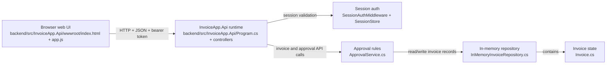

# As-Built Container Diagram

# Citations

- Browser UI assets: [backend/src/InvoiceApp.Api/wwwroot/index.html](../backend/src/InvoiceApp.Api/wwwroot/index.html), [backend/src/InvoiceApp.Api/wwwroot/app.js](../backend/src/InvoiceApp.Api/wwwroot/app.js)
- ASP.NET Core application startup and static-file hosting: [backend/src/InvoiceApp.Api/Program.cs](../backend/src/InvoiceApp.Api/Program.cs)
- API controller routes: [backend/src/InvoiceApp.Api/Controllers/InvoicesController.cs](../backend/src/InvoiceApp.Api/Controllers/InvoicesController.cs), [backend/src/InvoiceApp.Api/Controllers/AuthController.cs](../backend/src/InvoiceApp.Api/Controllers/AuthController.cs), [backend/src/InvoiceApp.Api/Controllers/ApprovalsController.cs](../backend/src/InvoiceApp.Api/Controllers/ApprovalsController.cs)
- Session authentication and role enforcement: [backend/src/InvoiceApp.Api/Auth/SessionAuthMiddleware.cs](../backend/src/InvoiceApp.Api/Auth/SessionAuthMiddleware.cs), [backend/src/InvoiceApp.Api/Auth/SessionStore.cs](../backend/src/InvoiceApp.Api/Auth/SessionStore.cs), [backend/src/InvoiceApp.Api/Auth/UserSession.cs](../backend/src/InvoiceApp.Api/Auth/UserSession.cs)
- Domain workflow rules: [backend/src/InvoiceApp.Domain/ApprovalService.cs](../backend/src/InvoiceApp.Domain/ApprovalService.cs)
- Repository contract and invoice model: [backend/src/InvoiceApp.Domain/IInvoiceRepository.cs](../backend/src/InvoiceApp.Domain/IInvoiceRepository.cs), [backend/src/InvoiceApp.Domain/Invoice.cs](../backend/src/InvoiceApp.Domain/Invoice.cs)
- In-memory implementation: [backend/src/InvoiceApp.Api/InMemoryInvoiceRepository.cs](../backend/src/InvoiceApp.Api/InMemoryInvoiceRepository.cs)
- Overall app description confirming the demo-only, in-memory design: [README.md](../README.md), [docs/About.txt](About.txt), [ops/README.md](../ops/README.md)

# Inferred Items

## Evidence-backed observations

- The runtime is a single ASP.NET Core process that serves the static web UI and exposes API controllers from the same app entry point; see [backend/src/InvoiceApp.Api/Program.cs](../backend/src/InvoiceApp.Api/Program.cs).
- The app uses session-based authentication and bearer tokens for protected API calls; see [backend/src/InvoiceApp.Api/Auth/SessionAuthMiddleware.cs](../backend/src/InvoiceApp.Api/Auth/SessionAuthMiddleware.cs) and [backend/src/InvoiceApp.Api/Controllers/AuthController.cs](../backend/src/InvoiceApp.Api/Controllers/AuthController.cs).
- The approval workflow is implemented in the domain layer and the controllers are thin API entry points; see [backend/src/InvoiceApp.Domain/ApprovalService.cs](../backend/src/InvoiceApp.Domain/ApprovalService.cs) and [backend/src/InvoiceApp.Api/Controllers/ApprovalsController.cs](../backend/src/InvoiceApp.Api/Controllers/ApprovalsController.cs).
- Invoice persistence is intentionally in-memory; the application wires the repository to `InMemoryInvoiceRepository`, and that class stores data in a local list rather than a database; see [backend/src/InvoiceApp.Api/Program.cs](../backend/src/InvoiceApp.Api/Program.cs) and [backend/src/InvoiceApp.Api/InMemoryInvoiceRepository.cs](../backend/src/InvoiceApp.Api/InMemoryInvoiceRepository.cs).

## Inferred items

- The browser and API are co-located in one deployment unit, because the app serves both static files and controllers from the same process.
- The as-built architecture is a lightweight demo runtime, not a distributed production deployment.

## Unsupported components corrected from the production scenario

- Database: not part of the current runtime; explicitly stated as future-only in [docs/About.txt](About.txt) and [ops/README.md](../ops/README.md).
- Message topic / event broker: not present in code and only described as a planned production scenario in [ops/README.md](../ops/README.md).
- Payment provider integration (PayEx): intentionally absent from the current code and described as future-only in [docs/About.txt](About.txt) and [ops/README.md](../ops/README.md).
- Background worker / consumer: not present in the app entry point or runtime code and therefore excluded from the as-built container view.
