# As-Built Container Diagram

```mermaid
flowchart LR
    User["User / Demo Operator\nREADME.md"]
    Browser["Browser UI\nbackend/src/InvoiceApp.Api/wwwroot/index.html\nbackend/src/InvoiceApp.Api/wwwroot/app.js"]

    subgraph AppContainer["InvoiceApp.Api Container\nbackend/src/InvoiceApp.Api/Program.cs"]
        UI["Static Web UI\nbackend/src/InvoiceApp.Api/wwwroot/index.html"]
        API["ASP.NET Core API\nbackend/src/InvoiceApp.Api/Controllers/AuthController.cs\nbackend/src/InvoiceApp.Api/Controllers/InvoicesController.cs"]
        Auth["SessionAuthMiddleware\nbackend/src/InvoiceApp.Api/Auth/SessionAuthMiddleware.cs"]
        Approval["ApprovalService\nbackend/src/InvoiceApp.Domain/ApprovalService.cs"]
        Repo["InMemoryInvoiceRepository\nbackend/src/InvoiceApp.Api/InMemoryInvoiceRepository.cs"]
        Sessions["SessionStore\nbackend/src/InvoiceApp.Api/Auth/SessionStore.cs"]
    end

    User --> Browser
    Browser -->|HTTP /api/auth/login, /api/invoices, /api/approvals| API
    Browser --> UI
    UI --> API
    API --> Auth
    API --> Approval
    Approval --> Repo
    Auth --> Sessions

    classDef app fill:#edf7ed,stroke:#2e8b57,color:#111;
    classDef data fill:#fff4e5,stroke:#d97706,color:#111;
    classDef user fill:#e8f1ff,stroke:#3b82f6,color:#111;

    class User user;
    class UI,API,Auth,Approval app;
    class Repo,Sessions data;
```

# Citations

- Browser client and demo user interaction: [README.md](../README.md) lists the local demo accounts, and [backend/src/InvoiceApp.Api/wwwroot/index.html](../backend/src/InvoiceApp.Api/wwwroot/index.html) plus [backend/src/InvoiceApp.Api/wwwroot/app.js](../backend/src/InvoiceApp.Api/wwwroot/app.js) show the browser UI and the `/api` calls it makes.
- Web app startup and runtime composition: [backend/src/InvoiceApp.Api/Program.cs](../backend/src/InvoiceApp.Api/Program.cs) configures the ASP.NET Core app, adds `SessionStore`, `InMemoryInvoiceRepository`, and `ApprovalService`, and runs the static UI with `UseStaticFiles()` and `MapControllers()`.
- Login and session validation: [backend/src/InvoiceApp.Api/Controllers/AuthController.cs](../backend/src/InvoiceApp.Api/Controllers/AuthController.cs) issues bearer tokens, and [backend/src/InvoiceApp.Api/Auth/SessionAuthMiddleware.cs](../backend/src/InvoiceApp.Api/Auth/SessionAuthMiddleware.cs) validates them for `/api` requests.
- Approval decision logic: [backend/src/InvoiceApp.Domain/ApprovalService.cs](../backend/src/InvoiceApp.Domain/ApprovalService.cs) implements the `Draft -> PendingApproval -> Approved/Rejected` lifecycle and persists the status update through the repository.
- In-memory persistence: [backend/src/InvoiceApp.Api/InMemoryInvoiceRepository.cs](../backend/src/InvoiceApp.Api/InMemoryInvoiceRepository.cs) stores invoices in a process-local list and is explicitly described as a no-database implementation.
- Session storage: [backend/src/InvoiceApp.Api/Auth/SessionStore.cs](../backend/src/InvoiceApp.Api/Auth/SessionStore.cs) keeps role-based sessions in memory keyed by bearer token.
- Planned production components are not part of the current runtime: [ops/README.md](../ops/README.md) explicitly states that database, topic, and payment-provider components are production-only scenarios, not code in the current app.

# Inferred Items

- The current runtime is a single ASP.NET Core process serving a static UI and API, without separate database, worker, queue, or payment services.
- The repository and session store are in-process implementation details, not containerized dependencies.
- The approval flow is synchronous and request-scoped: the browser calls the API, the domain service updates the invoice state, and the in-memory repository persists the result in the same process.
- The planned production elements described in [ops/README.md](../ops/README.md) and [docs/About.txt](../docs/About.txt) are intentionally omitted from the as-built diagram because they are not implemented in the current codebase.
