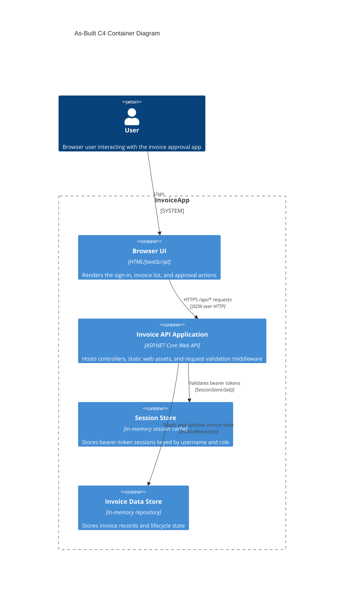

# As-Built C4 Container Diagram

## Mermaid

## Evidence

### Container Evidence

- Supported by code: Browser UI
  - `backend/src/InvoiceApp.Api/wwwroot/index.html` serves the browser UI and login/invoice/approval screens.
  - `backend/src/InvoiceApp.Api/wwwroot/app.js` runs the client logic, calls `/api/*` endpoints, stores bearer tokens in `sessionStorage`, and re-renders invoice data.
  - Symbols: `index.html` (HTML UI structure), `api(path, options)` and `render()` in `app.js`.

- Supported by code: Invoice API Application
  - `backend/src/InvoiceApp.Api/Program.cs` wires `AddControllers()`, static files, `UseMiddleware<SessionAuthMiddleware>()`, and `MapControllers()`.
  - `backend/src/InvoiceApp.Api/Controllers/AuthController.cs` exposes sign-in and sign-out endpoints.
  - `backend/src/InvoiceApp.Api/Controllers/InvoicesController.cs` exposes invoice list/create/submit/delete endpoints.
  - `backend/src/InvoiceApp.Api/Controllers/ApprovalsController.cs` exposes approval and rejection endpoints.
  - `backend/src/InvoiceApp.Api/Auth/SessionAuthMiddleware.cs` validates bearer tokens before allowing `/api` calls.
  - Symbols: `Program`, `AuthController.Login`, `AuthController.Logout`, `InvoicesController.GetAll`, `InvoicesController.Submit`, `ApprovalsController.Approve`, `ApprovalsController.Reject`, `SessionAuthMiddleware.InvokeAsync`.

- Supported by code: Session Store
  - `backend/src/InvoiceApp.Api/Auth/SessionStore.cs` creates, stores, retrieves, and removes sessions in a `ConcurrentDictionary<string, UserSession>`.
  - `backend/src/InvoiceApp.Api/Auth/UserSession.cs` defines the session object with `Username` and `Role`.
  - `backend/src/InvoiceApp.Api/Auth/SessionAuthMiddleware.cs` calls `_sessions.Get(token)` to authorize API requests.
  - Symbols: `SessionStore.Create`, `SessionStore.Get`, `UserSession`, `SessionAuthMiddleware.InvokeAsync`.

- Supported by code: Invoice Data Store
  - `backend/src/InvoiceApp.Domain/IInvoiceRepository.cs` defines the repository contract.
  - `backend/src/InvoiceApp.Api/InMemoryInvoiceRepository.cs` implements the repository with a `List<Invoice>` and thread-safe locking.
  - `backend/src/InvoiceApp.Domain/Invoice.cs` defines invoice fields and lifecycle properties (`Status`, `DecidedBy`, `DecisionNote`).
  - Symbols: `IInvoiceRepository`, `InMemoryInvoiceRepository.GetAll`, `InMemoryInvoiceRepository.GetById`, `InMemoryInvoiceRepository.Update`, `Invoice.Status`.

### Interaction Evidence

- Supported by code: Browser to API calls
  - `backend/src/InvoiceApp.Api/wwwroot/app.js` uses `fetch('/api...' ...)` and adds `Authorization: Bearer ${session.token}`.
  - Symbols: `api(path, options)`, `signOut()`, `render()`, `decide(path, payload)`.

- Supported by code: API to session validation
  - `backend/src/InvoiceApp.Api/Auth/SessionAuthMiddleware.cs` checks `Authorization` headers and calls `SessionStore.Get(token)` for all `/api` routes except `/api/auth/login`.
  - `backend/src/InvoiceApp.Api/Auth/RequireRoleAttribute.cs` checks `context.HttpContext.Items[HttpContextExtensions.SessionKey]` and compares `session.Role` to allowed roles.
  - Symbols: `SessionAuthMiddleware.InvokeAsync`, `RequireRoleAttribute.OnActionExecuting`.

- Supported by code: API to invoice repository
  - `backend/src/InvoiceApp.Api/Controllers/InvoicesController.cs` injects `IInvoiceRepository` and calls `_repository.Add`, `_repository.GetAll`, `_repository.GetById`, and `_repository.Update`.
  - `backend/src/InvoiceApp.Domain/ApprovalService.cs` updates invoice status and then calls `_repository.Update(invoice)`.
  - Symbols: `InvoicesController.Create`, `InvoicesController.GetAll`, `ApprovalService.Submit`, `ApprovalService.Approve`, `ApprovalService.Reject`.

## Inferred Items

- Inferred from code: The API application is a single runtime process serving both static web assets and API endpoints.
  - Justification: `backend/src/InvoiceApp.Api/Program.cs` calls `app.UseDefaultFiles()`, `app.UseStaticFiles()`, `app.UseMiddleware<SessionAuthMiddleware>()`, and `app.MapControllers()`, which together describe one ASP.NET Core host serving both UI and the API in the same process. No separate web-server or app-host container is declared elsewhere in the repository.

- Inferred from code: There are no external database, queue, or authentication service containers in the as-built system.
  - Justification: the repository and session state are implemented as in-memory objects within the API app (`InMemoryInvoiceRepository`, `SessionStore`), and authentication credentials are loaded from `backend/src/InvoiceApp.Api/appsettings.json` as configuration, not as a remote service. This is supported by code but is a runtime-level inference when naming the deployment containers.

# Sources

- `backend/src/InvoiceApp.Api/Program.cs`
- `backend/src/InvoiceApp.Api/Controllers/AuthController.cs`
- `backend/src/InvoiceApp.Api/Controllers/InvoicesController.cs`
- `backend/src/InvoiceApp.Api/Controllers/ApprovalsController.cs`
- `backend/src/InvoiceApp.Api/Auth/SessionAuthMiddleware.cs`
- `backend/src/InvoiceApp.Api/Auth/RequireRoleAttribute.cs`
- `backend/src/InvoiceApp.Api/Auth/SessionStore.cs`
- `backend/src/InvoiceApp.Api/Auth/UserSession.cs`
- `backend/src/InvoiceApp.Api/InMemoryInvoiceRepository.cs`
- `backend/src/InvoiceApp.Domain/IInvoiceRepository.cs`
- `backend/src/InvoiceApp.Domain/ApprovalService.cs`
- `backend/src/InvoiceApp.Domain/Invoice.cs`
- `backend/src/InvoiceApp.Domain/InvoiceStatus.cs`
- `backend/src/InvoiceApp.Api/appsettings.json`
- `backend/src/InvoiceApp.Api/wwwroot/index.html`
- `backend/src/InvoiceApp.Api/wwwroot/app.js`
