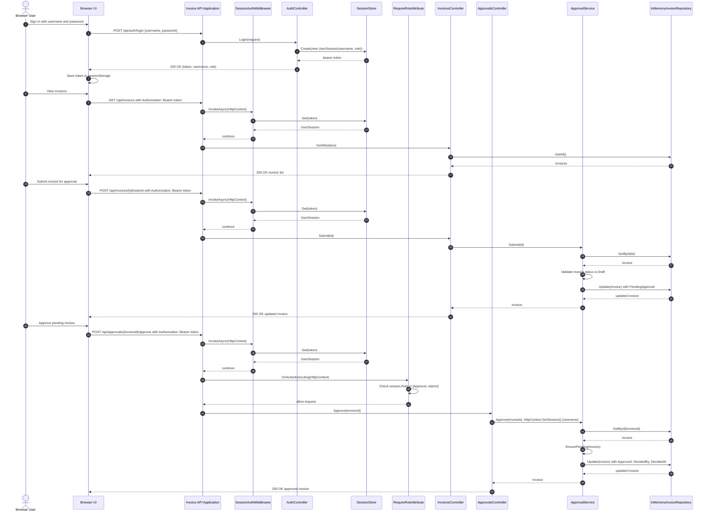

# Invoice Approval Sequence Diagram

## Mermaid

## Evidence

### Step Evidence

- Supported by code: Sign-in and token creation
  - `backend/src/InvoiceApp.Api/Controllers/AuthController.cs` defines `LoginRequest`, `LoginResponse`, and `AuthController.Login`. It validates username/password against `DemoUsersOptions` and calls `_sessions.Create(new UserSession(user.Username, user.Role))`.
  - `backend/src/InvoiceApp.Api/Auth/SessionStore.cs` defines `Create`, `Get`, and `Remove` for in-memory bearer tokens.
  - `backend/src/InvoiceApp.Api/appsettings.json` seeds demo users with roles `Approver` and `Admin`.

- Supported by code: Session validation for every API request
  - `backend/src/InvoiceApp.Api/Auth/SessionAuthMiddleware.cs` checks `Authorization` headers and calls `_sessions.Get(token)` for all `/api` routes except `/api/auth/login`.
  - `backend/src/InvoiceApp.Api/Auth/RequireRoleAttribute.cs` inspects `HttpContext.Items[SessionKey]` and returns `403` if the current session role is not allowed.
  - `backend/src/InvoiceApp.Api/Controllers/ApprovalsController.cs` is decorated with `[RequireRole("Approver", "Admin")]`, which gates approve/reject actions.

- Supported by code: Invoice submission workflow
  - `backend/src/InvoiceApp.Api/Controllers/InvoicesController.cs` defines `Submit(string id) => Handle(() => _approvals.Submit(id));`.
  - `backend/src/InvoiceApp.Domain/ApprovalService.cs` implements `Submit(string invoiceId)`. It loads the invoice, requires it to be `Draft`, sets `Status = InvoiceStatus.PendingApproval`, and calls `_repository.Update(invoice)`.

- Supported by code: Approval decision workflow
  - `backend/src/InvoiceApp.Api/Controllers/ApprovalsController.cs` defines `Approve(string invoiceId)` and `Reject(string invoiceId, RejectRequest request)` and reads the session username with `HttpContext.GetSession().Username`.
  - `backend/src/InvoiceApp.Domain/ApprovalService.cs` implements `Approve(string invoiceId, string approver)` and `Reject(string invoiceId, string approver, string reason)`.
  - `ApprovalService.Approve` sets `Status = InvoiceStatus.Approved`, `DecidedBy = approver`, `DecidedAt = DateTime.UtcNow`, and updates the repository.
  - `ApprovalService.Reject` requires a non-empty `reason`, sets `Status = InvoiceStatus.Rejected`, `DecisionNote = reason`, and updates the repository.

- Supported by code: Repository persistence and state change
  - `backend/src/InvoiceApp.Api/InMemoryInvoiceRepository.cs` implements `GetById` and `Update` with a thread-safe in-memory list.
  - `backend/src/InvoiceApp.Domain/Invoice.cs` stores `Status`, `DecidedBy`, `DecidedAt`, and `DecisionNote`.

## Inferred Items

- Inferred from code: The browser stores the bearer token in `sessionStorage` after login, and that token is attached to subsequent `/api` requests from the client.
  - Justification: `backend/src/InvoiceApp.Api/wwwroot/app.js` explicitly calls `sessionStorage.setItem('session', ...)` after login and adds `Authorization` headers to `fetch` requests. This is a client-side behavior, not a separate service container.

# Sources

- `backend/src/InvoiceApp.Api/Controllers/AuthController.cs`
- `backend/src/InvoiceApp.Api/Controllers/InvoicesController.cs`
- `backend/src/InvoiceApp.Api/Controllers/ApprovalsController.cs`
- `backend/src/InvoiceApp.Api/Auth/SessionAuthMiddleware.cs`
- `backend/src/InvoiceApp.Api/Auth/RequireRoleAttribute.cs`
- `backend/src/InvoiceApp.Api/Auth/SessionStore.cs`
- `backend/src/InvoiceApp.Api/Auth/UserSession.cs`
- `backend/src/InvoiceApp.Api/InMemoryInvoiceRepository.cs`
- `backend/src/InvoiceApp.Domain/ApprovalService.cs`
- `backend/src/InvoiceApp.Domain/IInvoiceRepository.cs`
- `backend/src/InvoiceApp.Domain/Invoice.cs`
- `backend/src/InvoiceApp.Domain/InvoiceStatus.cs`
- `backend/src/InvoiceApp.Api/appsettings.json`
- `backend/src/InvoiceApp.Api/wwwroot/app.js`
- `backend/src/InvoiceApp.Api/wwwroot/index.html`
