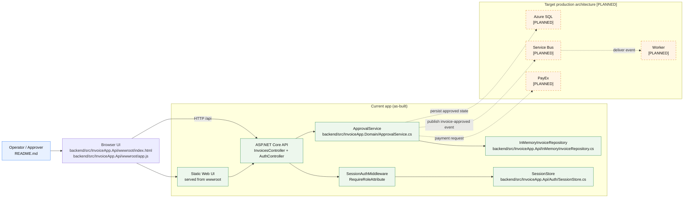

# Target Architecture

# Planned Components

- Azure SQL [PLANNED] — durable relational storage for invoices, approvals, audit records, and payment references.
- Service Bus [PLANNED] — event topic for invoice approval events and downstream processing.
- Worker [PLANNED] — background consumer for notifications and reconciliation work.
- PayEx [PLANNED] — external payment provider integration for approved invoices.

- Current app baseline: [README.md](../README.md), [backend/src/InvoiceApp.Api/Program.cs](../backend/src/InvoiceApp.Api/Program.cs), [backend/src/InvoiceApp.Domain/ApprovalService.cs](../backend/src/InvoiceApp.Domain/ApprovalService.cs), and [backend/src/InvoiceApp.Api/InMemoryInvoiceRepository.cs](../backend/src/InvoiceApp.Api/InMemoryInvoiceRepository.cs).
- Planned production evidence: [ops/README.md](../ops/README.md), [docs/About.txt](../docs/About.txt), [ops/incidents/INC-2047/servicebus-status.txt](../ops/incidents/INC-2047/servicebus-status.txt), and [ops/incidents/INC-2047/worker-logs.txt](../ops/incidents/INC-2047/worker-logs.txt).
