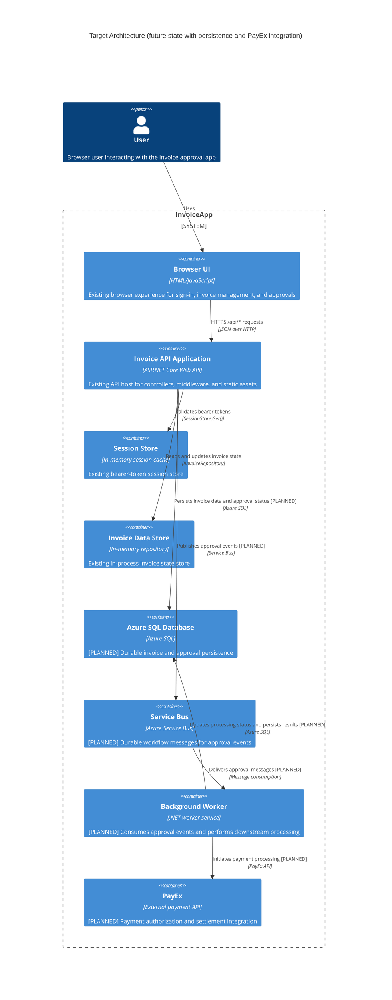

# Target Architecture

## Mermaid Diagram

## Existing Components

- Browser UI
  - Responsibility: Renders the sign-in screens, invoice list, and approvals dashboard.
  - Technology: HTML/JavaScript served from the API app.
  - Supporting Evidence: `backend/src/InvoiceApp.Api/wwwroot/index.html`; `backend/src/InvoiceApp.Api/wwwroot/app.js` (`api(path, options)`, `render()`, `signOut()`).

- Invoice API Application
  - Responsibility: Hosts the REST API, static files, middleware, and controller endpoints.
  - Technology: ASP.NET Core Web API.
  - Supporting Evidence: `backend/src/InvoiceApp.Api/Program.cs` (`AddControllers()`, `UseStaticFiles()`, `UseMiddleware<SessionAuthMiddleware>()`, `MapControllers()`).

- Session Store
  - Responsibility: Maintains bearer-token-based user session state in memory.
  - Technology: In-memory `ConcurrentDictionary<string, UserSession>`.
  - Supporting Evidence: `backend/src/InvoiceApp.Api/Auth/SessionStore.cs` (`Create`, `Get`, `Remove`); `backend/src/InvoiceApp.Api/Auth/UserSession.cs` (`UserSession`, `DemoUsersOptions`).

- Invoice Data Store
  - Responsibility: Persists the current invoice list and lifecycle state during app execution.
  - Technology: In-memory repository using a `List<Invoice>` and locking.
  - Supporting Evidence: `backend/src/InvoiceApp.Api/InMemoryInvoiceRepository.cs` (`GetAll`, `GetById`, `Add`, `Update`, `Remove`); `backend/src/InvoiceApp.Domain/IInvoiceRepository.cs` (`IInvoiceRepository`).

## Planned Components

- Azure SQL Database [PLANNED]
  - Why added: The current code implements an in-memory repository (`InMemoryInvoiceRepository`) and therefore has no durable persistence. A relational data store is required for long-lived invoice and approval state in a target architecture.
  - Status: Proposed design item; not supported by current code.

- Service Bus [PLANNED]
  - Why added: The current workflow is synchronous and in process. A durable messaging tier is required to decouple approval events from downstream processing and enable asynchronous handling between the API and workers.
  - Status: Proposed design item; not supported by current code.

- Background Worker [PLANNED]
  - Why added: The current app does not contain any background processing or worker service. A worker is needed to consume Service Bus messages and perform downstream fulfillment or reconciliation tasks.
  - Status: Proposed design item; not supported by current code.

- PayEx [PLANNED]
  - Why added: The repository contains no outbound payment client or external payment gateway integration. A payment provider integration is required to initiate or verify payment processing as part of the target state.
  - Status: Proposed design item; not supported by current code.

## Existing Interactions

- Browser UI -> Invoice API Application
  - Why it exists: The browser calls `/api/*` endpoints to authenticate, read invoices, submit invoices, and approve or reject them.
  - Supporting Evidence: `backend/src/InvoiceApp.Api/wwwroot/app.js` (`api(path, options)`, `refresh()`, `decide(path, payload)`); `backend/src/InvoiceApp.Api/Controllers/AuthController.cs` (`Login`, `Logout`); `backend/src/InvoiceApp.Api/Controllers/InvoicesController.cs` (`GetAll`, `Create`, `Submit`); `backend/src/InvoiceApp.Api/Controllers/ApprovalsController.cs` (`Approve`, `Reject`).

- Invoice API Application -> Session Store
  - Why it exists: Every `/api` request except login is checked for a valid bearer token in the session cache.
  - Supporting Evidence: `backend/src/InvoiceApp.Api/Auth/SessionAuthMiddleware.cs` (`InvokeAsync`); `backend/src/InvoiceApp.Api/Auth/SessionStore.cs` (`Get`).

- Invoice API Application -> Invoice Data Store
  - Why it exists: The controllers and approval service read, add, update, and remove invoice records.
  - Supporting Evidence: `backend/src/InvoiceApp.Api/Controllers/InvoicesController.cs` (`GetAll`, `GetById`, `Create`, `Delete`); `backend/src/InvoiceApp.Domain/ApprovalService.cs` (`Submit`, `Approve`, `Reject`).

- Invoice API Application -> Role gate
  - Why it exists: Approver and admin-specific actions are protected by role checks in the API pipeline.
  - Supporting Evidence: `backend/src/InvoiceApp.Api/Auth/RequireRoleAttribute.cs` (`OnActionExecuting`); `backend/src/InvoiceApp.Api/Controllers/ApprovalsController.cs` (`[RequireRole("Approver", "Admin")]`).

## Planned Interactions

- Invoice API Application -> Azure SQL Database [PLANNED]
  - Why added: This replaces the current in-memory repository pattern with durable persistence for invoice and approval data.
  - Status: Proposed design item; current code does not implement a SQL data layer.

- Invoice API Application -> Service Bus [PLANNED]
  - Why added: This decouples synchronous approval handling from downstream processing and supports reliable event propagation.
  - Status: Proposed design item; no message bus exists in current code.

- Service Bus -> Background Worker [PLANNED]
  - Why added: The worker must consume events from the queue and perform follow-on processing without blocking the API request path.
  - Status: Proposed design item; current code contains no worker or message consumer.

- Background Worker -> Azure SQL Database [PLANNED]
  - Why added: The worker needs a durable place to store processing results or workflow state while it handles downstream actions.
  - Status: Proposed design item; current code does not define a worker or persistence model outside the in-memory repository.

- Background Worker -> PayEx [PLANNED]
  - Why added: Payment authorization or settlement is a downstream action beyond the current synchronous invoice approval flow and requires an external payment integration.
  - Status: Proposed design item; no PayEx client or integration exists in the current repository.

## Design Rationale

- The baseline remains valid because the current repository clearly contains a browser UI, a single ASP.NET Core API host, in-memory session state, and an in-memory invoice repository. These were validated in the as-built artifacts and are preserved intact in the target architecture.
- The target design adds a durable data layer because the current system stores invoice state in `InMemoryInvoiceRepository` and the code does not declare any database or persistence provider.
- The target design adds Service Bus and a Background Worker because the current app handles approval logic synchronously within the API and `ApprovalService`, and there is no queuing or background processing in the code.
- The target design adds PayEx because the current repository contains no payment API client, no external gateway configuration, and no downstream payment processing path.

## Inferred Future-State Assumptions

- Assumption: Azure SQL is the persistence technology chosen for durable invoice data after the current in-memory implementation is replaced.
  - Justification: The requirement explicitly calls for Azure SQL persistence; no equivalent persistence technology is coded in the current repository.

- Assumption: The message-driven workflow will process approval events asynchronously after the API accepts the request.
  - Justification: Service Bus and a background worker are named in the target-state requirements, but the repo currently has no message bus or worker implementation.

- Assumption: PayEx is an external provider used only after the approval/processing workflow reaches the payment stage.
  - Justification: There is no current payment integration or client code in the repository, so this is a design-level addition for the target architecture.

## Sources

- Existing repository evidence:
  - `backend/src/InvoiceApp.Api/Program.cs` — `AddControllers()`, `UseStaticFiles()`, `UseMiddleware<SessionAuthMiddleware>()`, `MapControllers()`.
  - `backend/src/InvoiceApp.Api/wwwroot/index.html` — browser UI structure.
  - `backend/src/InvoiceApp.Api/wwwroot/app.js` — `api(path, options)`, `render()`, `signOut()`, `decide(path, payload)`.
  - `backend/src/InvoiceApp.Api/Auth/SessionAuthMiddleware.cs` — `InvokeAsync`, `GetSession`.
  - `backend/src/InvoiceApp.Api/Auth/SessionStore.cs` — `Create`, `Get`, `Remove`.
  - `backend/src/InvoiceApp.Api/Auth/RequireRoleAttribute.cs` — `OnActionExecuting`.
  - `backend/src/InvoiceApp.Api/Controllers/AuthController.cs` — `Login`, `Logout`.
  - `backend/src/InvoiceApp.Api/Controllers/InvoicesController.cs` — `GetAll`, `GetById`, `Create`, `Submit`, `Delete`.
  - `backend/src/InvoiceApp.Api/Controllers/ApprovalsController.cs` — `Approve`, `Reject`.
  - `backend/src/InvoiceApp.Domain/ApprovalService.cs` — `Submit`, `Approve`, `Reject`, `Find`, `EnsurePending`.
  - `backend/src/InvoiceApp.Api/InMemoryInvoiceRepository.cs` — `GetAll`, `GetById`, `Add`, `Update`, `Remove`.
  - `backend/src/InvoiceApp.Domain/IInvoiceRepository.cs` — `IInvoiceRepository`.

- Planned design rationale:
  - Azure SQL is required to replace the current in-memory repository and provide durable data retention.
  - Service Bus is required to decouple the approval workflow from downstream processing and create an asynchronous event boundary.
  - Background Worker is required to consume messages and perform downstream operations outside the API request thread.
  - PayEx is required to integrate an external payment provider because no current code implements such a dependency.
