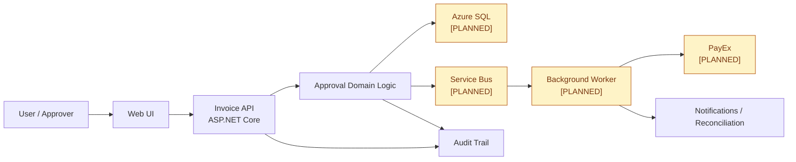

# Target Architecture

# Planned Components

- Azure SQL [PLANNED]: durable storage for invoice, approval, and audit data.
- Service Bus [PLANNED]: asynchronous event processing for downstream notifications and workflows.
- Worker [PLANNED]: background consumer that processes queued events and performs operational tasks.
- PayEx [PLANNED]: external payment provider integration for settlement or payout processing.

These are future-only components described in [ops/README.md](../ops/README.md) and [docs/About.txt](../docs/About.txt). They are intentionally not present in the current in-memory demo implementation.
